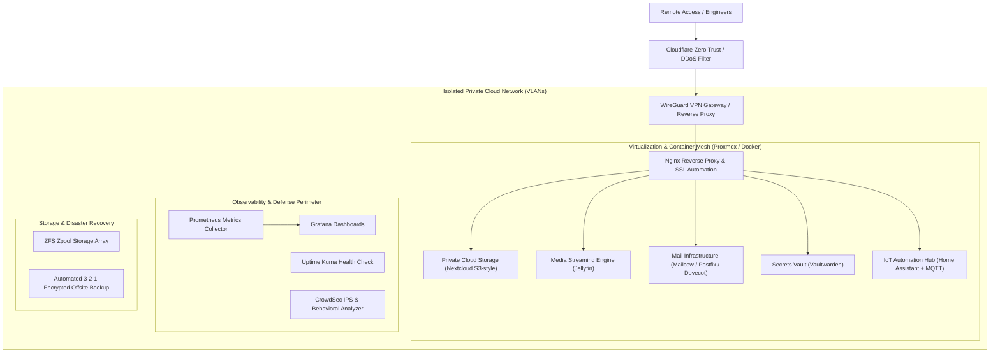

  

  
  
  
  

---

## 👨‍💻 Executive Summary

> **Multi-Domain Systems & Cloud Engineer** with practical expertise across **Cloud Infrastructure & Architecture (AWS & Private Cloud)**, **Cloud Security & Zero-Trust Hardening**, **System Administration (Linux & Windows Server)**, **QA Automation (Selenium & PyTest)**, and **IoT / Embedded Systems (ESP32 & Raspberry Pi)**.
>
> Architected and operate an enterprise-grade self-hosted **Private Cloud** modeled after AWS core architecture (Compute, Software-Defined Networking, ZFS Storage, Observability, and Disaster Recovery) while building automated CI/CD and QA testing pipelines.

---

## 🛠️ Technical Stack & Tools

  <table>
    <tr>
      <td align="center" width="160"><b>Cloud & Virtualization</b></td>
      <td>
        
        
        
        
        
      </td>
    </tr>
    <tr>
      <td align="center" width="160"><b>Cloud Security</b></td>
      <td>
        
        
        
        
        
      </td>
    </tr>
    <tr>
      <td align="center" width="160"><b>SysAdmin & Networks</b></td>
      <td>
        
        
        
        
        
      </td>
    </tr>
    <tr>
      <td align="center" width="160"><b>Observability</b></td>
      <td>
        
        
        
        
      </td>
    </tr>
    <tr>
      <td align="center" width="160"><b>QA & Test Automation</b></td>
      <td>
        
        
        
        
      </td>
    </tr>
    <tr>
      <td align="center" width="160"><b>IoT & Embedded</b></td>
      <td>
        
        
        
        
      </td>
    </tr>
  </table>

---

## 🏛️ Featured Architecture: Self-Hosted Private Cloud

Modeled after AWS core infrastructure tiers (Compute, Networking, Storage, Security, and Monitoring):

---

## 📂 Core Engineering Projects

| Repository | Focus Area | Description |
| :--- | :--- | :--- |
| **[`my-private-cloud`](https://github.com/Aryan-136/my-private-cloud)** | **Cloud & Infrastructure** | Full-stack AWS-inspired private cloud architecture, disaster recovery specifications, and deployment orchestration. |
| **[`infrastructure-monitoring`](https://github.com/Aryan-136/infrastructure-monitoring)** | **Observability** | Prometheus time-series metrics, Grafana dashboards, node-exporter, and Uptime Kuma SLA monitoring. |
| **[`self-hosted-security-services`](https://github.com/Aryan-136/self-hosted-security-services)** | **Cloud Security** | Zero-trust WireGuard VPN, Vaultwarden password management, CrowdSec behavioral IPS, and automated SSL/TLS. |
| **[`qa-automation-framework`](https://github.com/Aryan-136/qa-automation-framework)** | **QA & Test Engineering** | Selenium + PyTest Page Object Model framework, parallel cross-browser runs, API testing, and GitHub Actions CI/CD. |
| **[`docker-infrastructure`](https://github.com/Aryan-136/docker-infrastructure)** | **DevOps & Containers** | Production Docker daemon security hardening (CIS compliance), Portainer CE, Watchtower automated updates. |
| **[`iot-automation-platform`](https://github.com/Aryan-136/iot-automation-platform)** | **IoT & Edge Hardware** | Microcontroller telemetry on ESP32, isolated IoT VLAN, MQTT Mosquitto broker, and Home Assistant automation. |

---

## 📊 GitHub Analytics

  
  

---

## ☕ Support & Connect

  

